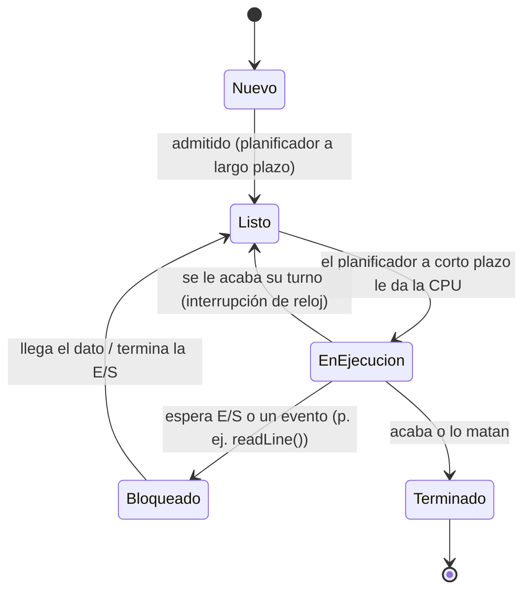
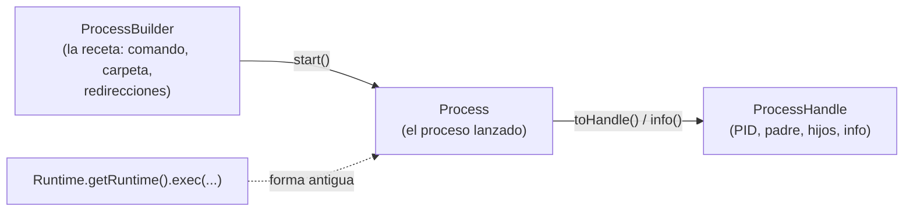
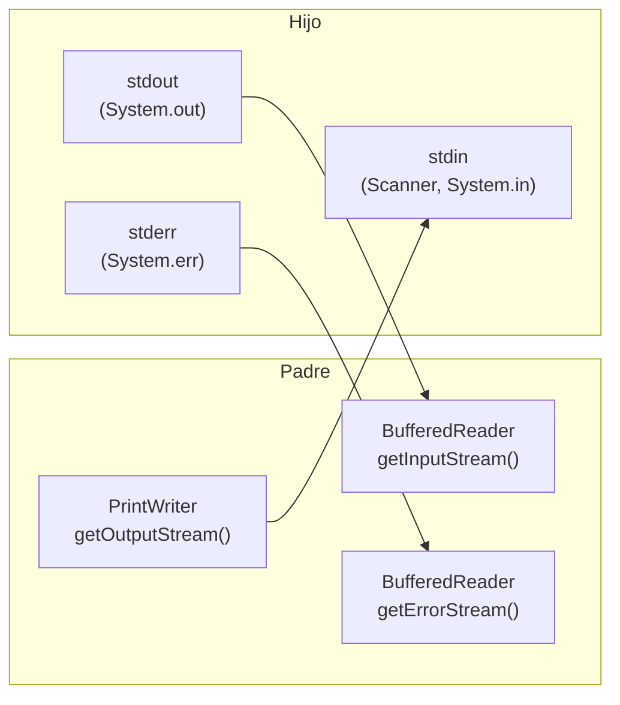

# UT1 · Programación multiproceso — Apuntes explicados

> Apuntes de estudio de la UT1 de PSP, desarrollados a partir de `psp-ut1.pdf` y de los ejercicios de clase.
> Todo el código está probado: las salidas son **reales** (Windows) y se indica qué cambia en **Linux**, que es donde se hace el examen.
> Soluciones completas de los ejercicios: [`../ejercicios/soluciones-ejercicios-processbuilder.md`](../ejercicios/soluciones-ejercicios-processbuilder.md) y [`../ejercicios/soluciones-comunicacion-procesos.md`](../ejercicios/soluciones-comunicacion-procesos.md). Código: [`../soluciones/`](../soluciones/).

## Índice

1. [Programa, proceso y ejecutable](#1-programa-proceso-y-ejecutable)
2. [Multitarea, concurrencia, paralelismo y distribución](#2-multitarea-concurrencia-paralelismo-y-distribución)
3. [El kernel y las interrupciones](#3-el-kernel-y-las-interrupciones)
4. [Estados de un proceso, colas y planificación](#4-estados-de-un-proceso-colas-y-planificación)
5. [Árbol de procesos: padres, hijos y PID](#5-árbol-de-procesos-padres-hijos-y-pid)
6. [Procesos en Java: `ProcessBuilder`, `Process`, `ProcessHandle`, `Runtime`](#6-procesos-en-java)
7. [Esperar, códigos de salida y terminar procesos](#7-esperar-códigos-de-salida-y-terminar-procesos)
8. [Comunicación: los tres canales (stdin, stdout, stderr)](#8-comunicación-los-tres-canales)
9. [Redirecciones a ficheros y tuberías](#9-redirecciones-a-ficheros-y-tuberías)
10. [Sincronización y la «regla de oro»](#10-sincronización-y-la-regla-de-oro)
11. [Java lanza Java](#11-java-lanza-java)
12. [Linux frente a Windows: chuleta de equivalencias](#12-linux-frente-a-windows)
13. [Tareas del PDF resueltas (1, 2 y 4)](#13-tareas-del-pdf-resueltas)
14. [Errores típicos](#14-errores-típicos)
15. [Chuleta final](#15-chuleta-final)

---

## 1. Programa, proceso y ejecutable

| Concepto | Qué es | Ejemplo |
|---|---|---|
| **Programa** | Lo que hay **en disco**: instrucciones + datos. Es algo **estático**. | `gnome-calculator`, `Ejercicio1.class` |
| **Proceso** | Un programa **en ejecución**. Es algo **dinámico**: nace, cambia de estado y muere. | La calculadora abierta, con PID 4321 |
| **Ejecutable** | Fichero con la información para que el SO cree un proceso a partir del programa | `.exe` en Windows, binarios ELF en Linux |

Un proceso es **más que el código**. Su **contexto** incluye:

- **Contador de programa (PC):** la siguiente instrucción que toca ejecutar.
- **Espacio de memoria:** código, datos, pila (*stack*) y montículo (*heap*).
- **Estado del procesador:** el valor de los registros.
- **Recursos del SO:** ficheros abiertos, PID, usuario, prioridad...

> Del **mismo programa** puede haber **varios procesos** a la vez (abre dos terminales: dos procesos de `bash`), y cada uno es **independiente**: su propia memoria, su propio PID.

### ¿Y Java?

Java **no genera `.exe`**: `javac` produce **bytecode** (`.class` o `.jar`), que **no** entiende el procesador. Lo ejecuta la **JVM** (`java`), que lo traduce a instrucciones de la CPU real **al vuelo** (*JIT, Just-In-Time*). Por eso:

- El **proceso** que ves en el sistema es `java` (la JVM), no «Ejercicio1».
- El mismo `.class` funciona en Linux, Windows o macOS: lo que cambia es la JVM.

```bash
javac -d bin src/PSP/Ejercicio1.java     # compilar: .java → bin/PSP/Ejercicio1.class
java -cp bin PSP.Ejercicio1              # ejecutar: la JVM carga la clase PSP.Ejercicio1 desde bin/
```

`-cp bin` (*classpath*) le dice a la JVM **dónde buscar** las clases. Sin él, `java PSP.Ejercicio1` no encuentra nada (error `ClassNotFoundException`).

**Ver los procesos del sistema:**

| | Linux | Windows |
|---|---|---|
| Lista de procesos | `ps -ef` · `top` · `htop` | `tasklist` · Administrador de tareas |
| Árbol de procesos | `pstree -p` | Process Explorer (Sysinternals) |
| Buscar uno | `ps -ef \| grep java` | `tasklist \| findstr java` |
| Matar uno | `kill PID` (SIGTERM) · `kill -9 PID` (SIGKILL) | `taskkill /PID n` · `taskkill /F /PID n` |

---

## 2. Multitarea, concurrencia, paralelismo y distribución

**Multitarea:** ejecutar **varios procesos en un mismo intervalo de tiempo**.

- **Con un solo procesador (núcleo):** no van «a la vez» de verdad. El SO los **intercala** muy rápido: ejecuta un trozo de uno, lo para, ejecuta otro... Parece simultáneo. Antes de cambiar, el SO **guarda el contexto** del proceso actual para poder reanudarlo exactamente donde estaba (**cambio de contexto**).
- **Con varios procesadores:** sí pueden ir varios a la vez de verdad, pero como casi siempre hay **más procesos que núcleos**, sigue habiendo intercalado.

> El cambio de contexto **no es gratis**: el tiempo total incluye ejecutar cada proceso **más** los cambios de contexto **más** lo que tarda el planificador del SO en decidir.

| Término | Idea | Ejemplo en la UT1 |
|---|---|---|
| **Programación concurrente** | Varios procesos que se ejecutan **a la vez durante un intervalo** (de verdad o intercalados) y **colaboran**: necesitan **comunicarse** y **sincronizarse** | Padre e hijo que se pasan datos (ejercicios de comunicación) |
| **Programación paralela** | Concurrente **en varios procesadores a la vez** para acabar antes | Ejercicio 14: contar primos con 3 hijos en paralelo |
| **Programación distribuida** | Los procesos están en **varios ordenadores** conectados por red | Lo veremos con *sockets* |

Sistemas multiprocesador:

| Tipo | Memoria | Ejemplo |
|---|---|---|
| **Fuertemente acoplados** | **Compartida** por todos los procesadores (bus común). Pueden ser **simétricos** (todos iguales) o **asimétricos** (maestro-esclavo) | Tu portátil con varios núcleos |
| **Débilmente acoplados** | Cada procesador tiene **su propia memoria** y su E/S | Un clúster |
| **Distribuidos** | Equipos independientes y heterogéneos en red: muy escalables, difíciles de mantener | Servicios en la nube |

**Comprobado en el ejercicio 7:** tres esperas de 3, 5 y 1 segundos.

```text
Versión A (secuencial): 10,48 s     ← 3 + 5 + 1 = 9 s (+ lo que tarda en arrancar cada proceso)
Versión B (paralela):    5,60 s     ← el más lento: 5 s
```

En paralelo, el tiempo total depende del proceso **más lento**; en secuencial, de la **suma** de todos.

---

## 3. El kernel y las interrupciones

El **kernel** (núcleo) es la parte central del SO: pequeña, muy optimizada y con acceso total al hardware. Funciona a base de **interrupciones**: suspender momentáneamente lo que se está ejecutando para atender algo y después volver.

Causas de interrupción:

1. **Hardware:** se pulsa una tecla, llega un paquete de red, termina una lectura de disco.
2. **Reloj (periódicas):** cada pocos milisegundos salta el **planificador a corto plazo** para decidir si cambia de proceso. Es lo que hace posible la multitarea.
3. **Llamadas al sistema (*system calls*):** una aplicación pide algo al kernel (abrir un fichero, **crear un proceso**…). La aplicación se suspende, el kernel hace el trabajo y le devuelve el control.

> Cuando en Java haces `pb.start()`, por debajo la JVM hace llamadas al sistema: en Linux, `fork`/`posix_spawn` + `exec`; en Windows, `CreateProcess`. Java te **abstrae** de esas diferencias.

---

## 4. Estados de un proceso, colas y planificación



| Estado | Significado |
|---|---|
| **Nuevo** | Se está creando: se carga el programa y se prepara |
| **Listo** | Podría ejecutarse, pero espera su turno de CPU |
| **En ejecución** | Está usando el procesador ahora mismo |
| **Bloqueado** (en espera) | No puede seguir hasta que pase algo: que llegue un dato, que termine una lectura... |
| **Terminado** | Ha acabado; el SO libera sus recursos (y guarda su **código de salida** para el padre) |

> Un `br.readLine()` sobre la salida de un hijo que aún no ha escrito nada deja al padre **bloqueado**: no gasta CPU, solo espera.

**Colas** que mantiene el SO:

- **Cola de procesos:** todos los del sistema.
- **Cola de preparados (listos):** esperando CPU.
- **Cola de bloqueados:** esperando un evento o E/S.

**Planificación:**

| Planificador | Qué decide | Cómo es |
|---|---|---|
| **A largo plazo** | Qué procesos nuevos entran en la cola de listos (regula cuántos hay en memoria) | Se ejecuta poco |
| **A corto plazo** | Cuál de los listos pasa a ejecutarse | Se ejecuta muchísimo: tiene que ser **muy rápido** y con algoritmos sencillos |

Tipos de planificación a corto plazo:

- **Sin desalojo (cooperativa):** un proceso solo deja la CPU si se bloquea o termina. Uno mal hecho puede acapararla.
- **Apropiativa (con desalojo):** el SO **le quita** la CPU cuando quiere (por tiempo o prioridad). Es la de los SO actuales.
- **Tiempo compartido (*Round Robin*):** cada proceso tiene un **quantum** de tiempo; al agotarlo, vuelve a la cola de listos.

**Cambio de contexto:** al cambiar de proceso, el SO guarda el **estado del proceso**, los **registros** y la **información de memoria** del que sale, y restaura los del que entra.

---

## 5. Árbol de procesos: padres, hijos y PID

- Un proceso **siempre** lo crea **otro** proceso (su **padre**). Al arrancar, el kernel crea el primero (`systemd`/`init`, con PID 1, en Linux) y de él cuelga todo lo demás: se forma un **árbol**.
- Cada proceso tiene un **PID** (*Process IDentifier*) único mientras vive.
- **Padre e hijo se ejecutan concurrentemente** (compiten por la CPU) y **no comparten memoria**: si quieren comunicarse, tienen que usar **ficheros, tuberías, sockets…** (lo que vemos en el punto 8).
- Recursos: en los SO actuales (Linux, Windows, macOS, Android) el hijo pide sus recursos **directamente al SO**, como cualquier otro proceso. En sistemas muy robustos el hijo solo puede usar un **subconjunto** de los del padre (así no puede saturar el sistema creando procesos).

En Java (ejercicio 11):

```java
ProcessHandle.current()     // este programa Java
p.children()                // hijos DIRECTOS
p.descendants()             // hijos, nietos, bisnietos... (todo el subárbol)
h.parent()                  // el padre (Optional)
```

Salida real en Windows con «un padre, dos hijos y un nieto»:

```text
children():    3
descendants(): 7
  PID 22920 · padre 22228 · C:\Windows\System32\conhost.exe
  PID 19332 · padre 22228 · ...\java.exe
  PID 1264  · padre 22228 · ...\java.exe
  PID 20788 · padre 19332 · C:\Windows\System32\conhost.exe
  PID 696   · padre 19332 · ...\java.exe          ← el nieto
  ...
```

> ⚠️ **Diferencia de Windows:** cada programa de consola lleva un proceso **`conhost.exe`** (el «anfitrión de consola») como hijo. Por eso salen más procesos de los que lanzaste. En **Linux** el mismo ejercicio da `children() = 2` y `descendants() = 3` (dos hijos y un nieto), que es lo que espera el enunciado.

---

## 6. Procesos en Java



### 6.1 `ProcessBuilder`: preparar y lanzar

```java
ProcessBuilder pb = new ProcessBuilder("ping", "-c", "3", "google.com");  // comando + argumentos
Process p = pb.start();                                                   // ahora SÍ se crea el proceso
```

- **Cada argumento es un `String` aparte.** `new ProcessBuilder("ping -c 3 google.com")` **falla**: buscaría un programa llamado literalmente «ping -c 3 google.com».
- También acepta un `String[]` o una `List<String>`: `new ProcessBuilder(args)` lanza lo que llegue por la línea de comandos (ejercicio 3).
- `start()` **no espera**: crea el proceso y sigue. Padre e hijo corren a la vez.
- Si el ejecutable **no existe**, `start()` lanza **`IOException`**: el proceso **nunca llega a existir** (no tiene código de salida). Ejercicio 6 de comunicación: `[NO EXISTE] comandoInventado`.

| Método de `ProcessBuilder` | Para qué |
|---|---|
| `command(String...)` / `command()` | Cambiar / consultar el comando |
| `directory(File)` | **Carpeta de trabajo** del hijo (ejercicio 6) |
| `redirectInput/Output/Error(...)` | Conectar sus canales a ficheros (punto 9) |
| `redirectErrorStream(true)` | Mezclar errores con la salida normal |
| `inheritIO()` | El hijo usa la **misma consola** que el padre |
| `environment()` | Mapa de variables de entorno del hijo |
| `start()` | Lanza el proceso y devuelve un `Process` |
| `ProcessBuilder.startPipeline(lista)` | Lanza varios encadenados (tubería) |

**No hay shell.** `ProcessBuilder` lanza el programa **directamente**, sin pasar por `bash` ni `cmd`. Consecuencias:

- No funcionan `|`, `>`, `&&`, `*`, `~` ni las variables `$HOME`: eso lo hace la **shell**, no el programa.
- Si los necesitas, lanza la shell tú: `new ProcessBuilder("sh", "-c", "ls | wc -l")` (Linux) o `new ProcessBuilder("cmd", "/c", "dir | find /c \".\"")` (Windows).
- Las comillas de la terminal **no hacen falta**: `date "+%H"` en la terminal es `new ProcessBuilder("date", "+%H")` en Java (ejercicio 3 de comunicación).
- **En Windows**, muchas órdenes (`dir`, `echo`, `mkdir`, `type`, `copy`) **no son programas**: son internas de `cmd`. Hay que lanzarlas como `cmd /c mkdir pruebas`.

### 6.2 `Process`: el proceso lanzado

| Método | Qué hace |
|---|---|
| `pid()` | Su PID |
| `waitFor()` | **Bloquea** al padre hasta que el hijo termine; devuelve el **código de salida** |
| `waitFor(long, TimeUnit)` | Espera **como máximo** ese tiempo; `true` si terminó |
| `exitValue()` | Código de salida. Si aún vive → `IllegalThreadStateException` |
| `isAlive()` | `true` si sigue en ejecución |
| `destroy()` | **Pide** que termine (SIGTERM en Linux) |
| `destroyForcibly()` | **Obliga** a terminar (SIGKILL en Linux) |
| `getInputStream()` | Leer lo que el hijo escribe en **su salida** |
| `getErrorStream()` | Leer lo que el hijo escribe en **su salida de error** |
| `getOutputStream()` | Escribir en **su entrada** |
| `children()` / `descendants()` | Sus hijos / todo el subárbol |
| `info()` | Información del SO (comando, inicio, usuario, CPU...) |
| `toHandle()` | El `ProcessHandle` del proceso |

> ⚠️ **Los nombres engañan.** `getInputStream()` devuelve un flujo de **entrada para el padre** que está conectado a la **salida** del hijo. Piensa siempre **desde el punto de vista del padre**: lo que *entra* al padre es lo que *sale* del hijo.

### 6.3 `ProcessHandle` e `info()`

`ProcessHandle` representa **cualquier proceso del sistema**, no solo los que lanzaste:

```java
ProcessHandle yo = ProcessHandle.current();                // este programa
Optional<ProcessHandle> otro = ProcessHandle.of(12345);    // cualquier PID (vacío si no existe)
ProcessHandle.Info info = p.info();
System.out.println("Comando: " + info.command().orElse("-"));
System.out.println("Inicio:  " + info.startInstant().map(Object::toString).orElse("-"));
```

Métodos de `ProcessHandle.Info`: `command()`, `commandLine()`, `arguments()`, `startInstant()`, `totalCpuDuration()`, `user()`. **Todos devuelven `Optional`**, porque el SO puede no dar ese dato (por permisos o porque el proceso ya terminó). `orElse(valor)` da un valor por defecto en vez de un `null` y evita el `NullPointerException`.

> En Windows `commandLine()` suele venir vacío para procesos ajenos y `command()` sí trae la ruta. Por eso en las soluciones se usa `commandLine().orElse(command().orElse("?"))`.

### 6.4 `Runtime.exec()`: la forma antigua

```java
Process p = Runtime.getRuntime().exec(new String[]{"ping", "-c", "3", "google.com"});
```

Hace lo mismo que `new ProcessBuilder(...).start()`, pero sin las opciones de configuración (carpeta, redirecciones...). La versión `exec(String)` con todo en una cadena está **obsoleta** desde Java 18, porque parte por espacios y da problemas con rutas que los tienen. **Usa `ProcessBuilder`.**

---

## 7. Esperar, códigos de salida y terminar procesos

### 7.1 El código de salida

Cuando un proceso termina, deja un número para su padre: el **código de salida** (*exit code*). Por convenio, **0 = todo bien** y **cualquier otro valor = algo falló**. Cada programa decide qué significa cada número:

| Programa | Códigos |
|---|---|
| `grep` | 0 encontrado · 1 no encontrado · 2 error (p. ej., el fichero no existe) |
| `mkdir pruebas` (2.ª vez) | 1 («File exists» en Linux / «Ya existe» en Windows) |
| `ping` | 0 responde · ≠0 no responde |
| Un programa Java | Lo que pase a `System.exit(n)` (0 si termina normal) |

```java
int codigo = p.waitFor();          // espera Y devuelve el código
int codigo = p.exitValue();        // solo si YA terminó; si no, excepción
```

**Linux frente a Windows (ejercicio 8, comprobado):**

| `System.exit(...)` en el hijo | Padre en **Linux** | Padre en **Windows** |
|---|---|---|
| `0`, `5`, `42` | 0, 5, 42 | 0, 5, 42 |
| `300` | **44** | 300 |
| `-1` | **255** | -1 |

En Linux el código de salida es **1 byte (0-255)**: se queda con `n mod 256` (300 → 44; −1 → 255). En Windows es un entero de 32 bits. **Limitación:** con el código de salida solo se puede devolver un número pequeño; para devolver datos de verdad (un texto, un resultado grande) hay que usar la **salida estándar** (punto 8).

### 7.2 Esperar con tiempo límite (ejercicio 9)

```java
Process p = new ProcessBuilder("sleep", "10").start();
boolean terminado = p.waitFor(3, TimeUnit.SECONDS);   // espera MÁXIMO 3 s
if (!terminado) {
    p.destroy();                                       // pide que termine
    p.waitFor();                                       // destroy() no espera: hay que esperar
}
System.out.println(p.exitValue());
```

### 7.3 `destroy()` frente a `destroyForcibly()`

| | Linux | Windows |
|---|---|---|
| `destroy()` | Envía **SIGTERM** (señal 15): «por favor, termina». El proceso **puede capturarla o ignorarla** (`trap '' TERM`) | `TerminateProcess`: termina **sí o sí** |
| `destroyForcibly()` | Envía **SIGKILL** (señal 9): el kernel lo mata. **No se puede ignorar** | Lo mismo que `destroy()` |
| Código de salida tras matarlo | **128 + señal** → 143 (SIGTERM), 137 (SIGKILL) | **1** |

Por eso en el ejercicio 10 (*el proceso rebelde*) en Linux `destroy()` **no** consigue terminarlo y hay que usar `destroyForcibly()`; en Windows `destroy()` ya lo termina (salida real: `¿Ha terminado con destroy()?: true · Código de salida: 1`).

> **Buena práctica:** primero `destroy()` (le das la oportunidad de cerrar ficheros, guardar...) y solo si no termina en un tiempo razonable, `destroyForcibly()`. Es lo que hace el `GestorProcesos`.

---

## 8. Comunicación: los tres canales

Todo proceso tiene tres canales estándar:

| Canal | Número | En Java (hijo) | Desde el padre se usa... |
|---|---|---|---|
| **Entrada estándar** (stdin) | 0 | `System.in` / `Scanner` | `p.getOutputStream()` → **escribir** en él |
| **Salida estándar** (stdout) | 1 | `System.out` | `p.getInputStream()` → **leer** de él |
| **Salida de error** (stderr) | 2 | `System.err` | `p.getErrorStream()` → **leer** de él |



Un proceso lanzado con `ProcessBuilder` **no tiene terminal**: si el padre no lee su salida, nadie la ve (salvo que uses `inheritIO()`).

### 8.1 Leer la salida del hijo

```java
Process p = new ProcessBuilder("echo", "Hola desde el hijo").start();
BufferedReader br = new BufferedReader(new InputStreamReader(p.getInputStream()));
String linea;
while ((linea = br.readLine()) != null) {     // null = el hijo cerró su salida (terminó)
    System.out.println("[HIJO] " + linea);
}
br.close();
int codigo = p.waitFor();                       // DESPUÉS de leer
```

- `InputStream` lee **bytes**; `InputStreamReader` los convierte en **caracteres**; `BufferedReader` añade `readLine()`.
- **Por bytes** (`in.read()` devuelve un `int` 0-255, o −1 al final) o **por líneas** (`readLine()`): Tarea 2.
- **Codificación:** en Windows, programas de consola como `ping` escriben en la codificación antigua de la consola (CP850), y por eso la lectura por bytes muestra «Estad¡sticas». En Linux todo es UTF-8 y no pasa.

### 8.2 Leer los errores

```java
BufferedReader err = new BufferedReader(new InputStreamReader(p.getErrorStream()));
```

O mezclarlos con la salida normal y leer solo un flujo:

```java
pb.redirectErrorStream(true);   // stderr va al mismo sitio que stdout
```

> No todos los programas usan stderr para avisar: el `ping` de **Windows** escribe «no se pudo encontrar el host» por la **salida normal**. Por eso, además de leer, hay que mirar el **código de salida**.

### 8.3 Enviar datos al hijo

```java
PrintWriter pw = new PrintWriter(p.getOutputStream());
pw.println("2^10");
pw.close();      // o flush(), según el caso
```

| | `flush()` | `close()` |
|---|---|---|
| Qué hace | Envía **ya** lo que hay en el búfer | Envía y **cierra** el canal |
| El hijo ve... | Los datos; puede esperar más | Los datos y luego **fin de entrada** (`readLine()` → null, `hasNextLine()` → false) |
| Cuándo | **Conversación**: mando, leo respuesta, mando otra... (ejercicios 9, 10, 15) | **Envío único**: el hijo procesa hasta el final (`bc`, `tr`: ejercicios 7 y 8) |

> Si te olvidas del `close()` con `bc` o `tr`, el hijo se queda **esperando más datos para siempre** y el padre se bloquea en `readLine()`: **interbloqueo** (*deadlock*).

### 8.4 Protocolo

Cuando padre e hijo conversan, tienen que acordar unas **reglas**: qué se envía, en qué formato, qué se responde y cómo se termina. Eso es un **protocolo**. El del ejercicio 10:

1. Una petición por línea: `número operador número`.
2. Una respuesta por línea: el resultado o `ERROR`.
3. `fin` termina la conversación.

---

## 9. Redirecciones a ficheros y tuberías

En vez de leer y escribir desde Java, se pueden **conectar los canales del hijo a ficheros**: los datos **no pasan por Java**.

```java
pb.redirectInput(new File("datos/notas.csv"));            // como  < notas.csv
pb.redirectOutput(new File("datos/notas_ordenadas.csv")); // como  > notas_ordenadas.csv (sobrescribe)
pb.redirectError(new File("errores.txt"));                // como  2> errores.txt
pb.redirectOutput(ProcessBuilder.Redirect.appendTo(new File("diario.log")));   // como >> (añade)
pb.redirectOutput(ProcessBuilder.Redirect.INHERIT);       // a la consola del padre
pb.inheritIO();                                           // los TRES canales heredados
```

| `ProcessBuilder.Redirect` | Significado |
|---|---|
| `PIPE` | **Por defecto**: tubería entre padre e hijo (lo que lees con `getInputStream()`) |
| `INHERIT` | Usar el mismo canal que el padre (la consola) |
| `to(File)` | A un fichero, **sobrescribiendo** |
| `appendTo(File)` | A un fichero, **añadiendo** al final |
| `from(File)` | Leer la entrada de un fichero |
| `DISCARD` | Tirar la salida (a `/dev/null` o `NUL`) |

> La redirección se configura **en el `ProcessBuilder` antes de `start()`**. Si redirigiste la salida a un fichero, `getInputStream()` ya no trae nada.

**Tuberías (*pipelines*)** — ejercicio 13: la salida de un proceso es la entrada del siguiente, como `|` en la terminal:

```java
List<ProcessBuilder> tuberia = new ArrayList<ProcessBuilder>();
ProcessBuilder tr = new ProcessBuilder("tr", "-cs", "A-Za-z", "\n");
tr.redirectInput(new File("datos/texto.txt"));
tuberia.add(tr);
tuberia.add(new ProcessBuilder("sort", "-u"));
tuberia.add(new ProcessBuilder("wc", "-l"));
List<Process> procesos = ProcessBuilder.startPipeline(tuberia);
// el padre lee SOLO del último: los demás escriben en la tubería, no hacia Java
```

Equivale a `tr -cs 'A-Za-z' '\n' < datos/texto.txt | sort -u | wc -l` → **11** palabras distintas.

---

## 10. Sincronización y la «regla de oro»

Los métodos de comunicación **también sincronizan**:

- La comunicación padre-hijo por tubería es **unidireccional y bloqueante**.
- Si el padre lee (`readLine()`) y el hijo aún no ha escrito, el padre **se bloquea** hasta que llegue algo.
- `waitFor()` bloquea al padre hasta que el hijo **termina**.

> ### ⚠️ Regla de oro: primero LEER la salida, después `waitFor()`
> Las tuberías tienen un **búfer limitado** (unos 64 KB en Linux). Si el hijo escribe mucho y el padre está parado en `waitFor()` sin leer, el búfer se llena, **el hijo se bloquea** esperando a que alguien lea... y el padre está esperando a que el hijo termine. **Ninguno avanza: interbloqueo.** Por eso se lee primero hasta `null` y **luego** se espera.

Lo mismo con stderr: si el hijo escribe muchos errores y nadie los lee, también se puede bloquear. Por eso en el ejercicio 6 se usa `redirectErrorStream(true)` y **se consume toda la salida** aunque solo interese la primera línea.

**Otras formas de comunicarse** (no son de esta unidad):

- **Sockets:** comunicación por red (UT de servicios).
- **JNI** (*Java Native Interface*): llamar desde Java a código nativo en C para hacer cosas de bajo nivel.
- **Librerías no estándar:** memoria compartida, tuberías con nombre, semáforos…

### Diseñar un programa multiproceso cooperativo

1. **Descomposición funcional:** identificar las funciones de la aplicación y cómo se relacionan.
2. **Partición:** repartir las funciones entre procesos y diseñar cómo se comunican. **Maximiza la independencia**: sincronizar cuesta tiempo.
3. **Implementación.**

---

## 11. Java lanza Java

Para lanzar otra clase Java como proceso hijo se usa el **comando `java`** con el *classpath* y el **nombre completo** de la clase (paquete incluido, sin `.class`):

```java
new ProcessBuilder("java", "-cp", "bin", "PSP.Hijo", "5").start();
//                  JVM    dónde están   clase      argumentos de su main
//                         las clases
```

- La ruta `bin` es **relativa a la carpeta de trabajo** del padre: hay que ejecutar el padre **desde la raíz del proyecto** (donde está `bin/`). IntelliJ ya lo hace así.
- La clase hija tiene que estar **compilada** antes de lanzar al padre.
- El hijo es **otra JVM**: otro proceso, otra memoria. Solo se comunican por los canales del punto 8 o por el código de salida.
- Igual en Linux y en Windows.

---

## 12. Linux frente a Windows

| Quiero... | Linux (examen) | Windows (casa) |
|---|---|---|
| Calculadora | `gnome-calculator` / `kcalc` | `calc.exe` |
| Editor de texto | `gedit` / `gnome-text-editor` / `kate` | `notepad.exe` |
| Esperar n segundos | `sleep n` | `powershell -NoProfile -Command "Start-Sleep n"` |
| Crear carpeta | `mkdir pruebas` | `cmd /c mkdir pruebas` |
| Fichero vacío | `touch f.txt` | `cmd /c type nul > f.txt` |
| Ping de 1 paquete | `ping -c 1 host` | `ping -n 1 host` |
| Eco | `echo Hola` | `cmd /c echo Hola` (palabras sueltas, si no salen comillas) |
| Hora (HH) | `date +%H` | `powershell -NoProfile -Command "Get-Date -Format HH"` |
| Listar por tamaño | `ls -S carpeta` | `cmd /c dir /b /o-s /a-d carpeta` |
| Buscar texto con nº de línea | `grep -n palabra fichero` | `findstr /n palabra fichero` (ruta con `\`) |
| Calculadora de texto | `bc -l` | PowerShell leyendo de su entrada (otra sintaxis) |
| `tr`, `sort -t -k`, `wc`, `uniq`, `head` | Del sistema | Los de Git: `C:/Program Files/Git/usr/bin/` |
| Shell para tuberías | `sh -c "a | b"` | `cmd /c "a | b"` |
| Ignorar SIGTERM | `sh -c "trap '' TERM; sleep 30"` | No hay señales |
| Ver procesos | `ps -ef`, `pstree -p` | `tasklist`, Process Explorer |
| Matar | `kill` / `kill -9` | `taskkill` / `taskkill /F` |

---

## 13. Tareas del PDF resueltas

Código en [`../soluciones/tareas/`](../soluciones/tareas/).

### Tarea 1 · Lanzar programas y mostrar su información

```java
Process p = new ProcessBuilder(programa).start();
ProcessHandle.Info info = p.info();
System.out.println("Aplicación: " + info.command().orElse(programa[0]));
System.out.println("  PID:     " + p.pid());
System.out.println("  Inicio:  " + info.startInstant().map(Object::toString).orElse("desconocido"));
// segunda parte: por cada proceso
p.waitFor(3, TimeUnit.SECONDS);
p.destroy();
System.out.println("Código de salida: " + p.waitFor());
```

Salida real (Windows, sin argumentos):

```text
Aplicación: C:\Windows\System32\WindowsPowerShell\v1.0\powershell.exe
  PID:     6228
  Inicio:  2026-11-09T12:15:54.876Z
Aplicación: C:\Windows\System32\PING.EXE
  PID:     24176
PID 6228 eliminado. Código de salida: 1      ← en Linux: 143 (SIGTERM)
```

### Tarea 2 · ProcessCom: mostrar la salida y los errores (por bytes y por líneas)

- **Por bytes:** `int c; while ((c = in.read()) != -1) System.out.print((char) c);`. Cuidado: un carácter con tilde en UTF-8 son **2 bytes**, y al convertir byte a byte sale roto.
- **Por líneas:** `BufferedReader.readLine()`.
- Después se lee `getErrorStream()` para avisar de si hubo errores, y se muestra el código de salida.

### Tarea 4 · RunAndWait y ModRunAndWait

- `Sumador` suma sus `args` y lo escribe en `System.out`.
- `RunAndWait` lanza `java -cp bin PSP.Sumador 3 4 5` con **`redirectOutput(fichero)`**: el resultado va al `.txt` **sin pasar por Java**. Espera con `waitFor()` y muestra el comando y lo que devolvió.
- `ModRunAndWait` lanza **tres** `Sumador` a la vez, cada uno a su fichero; **espera a los tres** (si no, el fichero podría estar aún vacío), los lee y suma.

```text
Lanzado: java -cp bin PSP.Sumador 1 2 3  >  parcial1.txt
Lanzado: java -cp bin PSP.Sumador 10 20  >  parcial2.txt
Lanzado: java -cp bin PSP.Sumador 100 200 300  >  parcial3.txt
parcial1.txt = 6 (código 0)
parcial2.txt = 30 (código 0)
parcial3.txt = 600 (código 0)
Suma total: 636
```

---

## 14. Errores típicos

| Síntoma | Causa | Arreglo |
|---|---|---|
| `IOException: Cannot run program "ping -c 1 google.com"` | Todo el comando en un solo `String` | Un `String` por argumento: `("ping", "-c", "1", "google.com")` |
| `IOException: Cannot run program "dir"` (Windows) | `dir`, `echo`, `mkdir`, `type` son internos de `cmd` | `("cmd", "/c", "dir")` |
| `ls | wc -l` no funciona | `ProcessBuilder` no usa shell: `|` no significa nada | `("sh", "-c", "ls | wc -l")` o `startPipeline` |
| El programa se queda colgado | `waitFor()` antes de leer, o falta `close()` al enviar a `bc`/`tr` | Leer hasta `null` y luego `waitFor()`; `close()` en envíos únicos |
| El hijo no recibe la frase | Falta `flush()` | `pw.println(...); pw.flush();` |
| `IllegalThreadStateException` | `exitValue()` con el proceso vivo | `waitFor()` antes, o comprobar `isAlive()` |
| `ClassNotFoundException: PSP.Hijo` | El padre no se ejecuta desde la raíz del proyecto, o el hijo no está compilado | Ejecutar desde donde está `bin/` y compilar todo |
| `error: illegal unicode escape` al compilar | En Java, `\u` se interpreta **incluso en comentarios**: `C:\Program Files\Git\usr\bin` no compila | Usar `/` en los comentarios o escribir `\\u` |
| `cmd /c echo` muestra comillas | Java pone comillas a los argumentos con espacios y `echo` las imprime | Pasar las palabras por separado |
| `findstr` no abre `datos/texto.txt` | `findstr` toma la `/` como opción | Ruta con `\` (`File.separatorChar`) |
| El `sort` de Windows no entiende `-t, -k2` | No es el `sort` de Linux | El de Git (`C:/Program Files/Git/usr/bin/sort.exe`) |
| En Linux, el código de salida de `System.exit(300)` es 44 | Linux guarda 1 byte (0-255) | Devolver datos por stdout, no por el código |

---

## 15. Chuleta final

```java
// Lanzar
ProcessBuilder pb = new ProcessBuilder("comando", "arg1", "arg2");
pb.directory(new File("carpeta"));            // carpeta de trabajo
Process p = pb.start();                        // IOException si no existe

// Leer su salida (PRIMERO leer, DESPUÉS waitFor)
BufferedReader br = new BufferedReader(new InputStreamReader(p.getInputStream()));
String l; while ((l = br.readLine()) != null) { ... }
int codigo = p.waitFor();                      // 0 = bien

// Enviarle datos
PrintWriter pw = new PrintWriter(p.getOutputStream());
pw.println("dato"); pw.flush();                // conversación
pw.close();                                    // fin de la entrada

// Errores
p.getErrorStream()  ·  pb.redirectErrorStream(true)

// Ficheros y tuberías
pb.redirectInput(f) · pb.redirectOutput(f) · Redirect.appendTo(f) · pb.inheritIO()
ProcessBuilder.startPipeline(listaDeBuilders)

// Controlar
p.pid() · p.isAlive() · p.waitFor(3, TimeUnit.SECONDS) · p.exitValue()
p.destroy() (SIGTERM, 143) · p.destroyForcibly() (SIGKILL, 137)
ProcessHandle.current() · ProcessHandle.of(pid) · p.children() · p.descendants()
p.info().command() / commandLine() / startInstant()   → Optional: .orElse("-")

// Java lanza Java (desde la raíz del proyecto)
new ProcessBuilder("java", "-cp", "bin", "PSP.Hijo", "arg").start();
```

**Las 7 ideas que no pueden faltar en el examen:**

1. Programa = estático en disco; proceso = programa en ejecución (con PID, memoria y estado).
2. `start()` no espera; `waitFor()` sí.
3. Un `String` por argumento y **sin shell**: nada de `|`, `>` ni comillas.
4. `getInputStream()` = lo que **sale** del hijo; `getOutputStream()` = lo que **entra** al hijo.
5. **Primero leer, después `waitFor()`**; `close()` para terminar de enviar y `flush()` para seguir hablando.
6. `destroy()` pide (SIGTERM, 143), `destroyForcibly()` obliga (SIGKILL, 137). Código de salida en Linux: 0-255.
7. Java lanza Java con `java -cp bin paquete.Clase` desde la raíz del proyecto.
